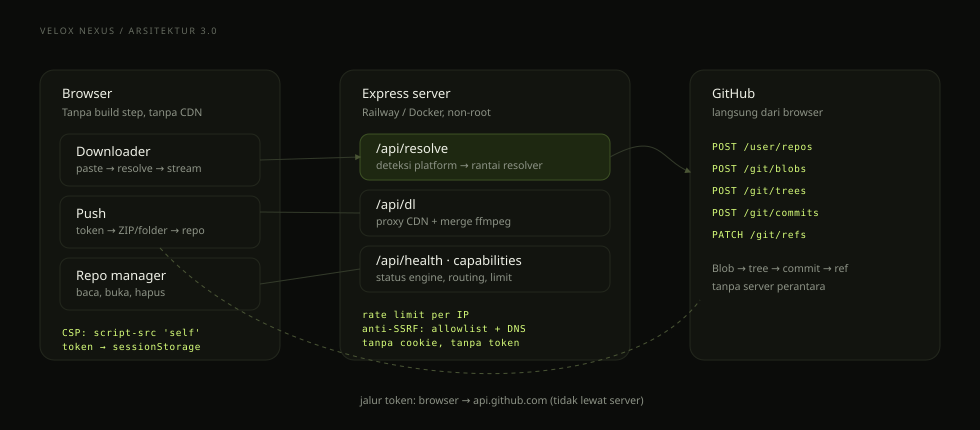

# VELOX NEXUS

**Satu workspace untuk menyimpan media dan mengirimnya ke GitHub.**
34 platform · rantai resolver adaptif · token GitHub yang tidak pernah menyentuh server.

<p align="center">
  
</p>

---

## Apa ini

VELOX NEXUS adalah penggabungan dua alat yang sebelumnya terpisah:

| Asal | Yang dibawa masuk |
|------|-------------------|
| **VeloxXhastag-Dl** | Engine downloader: deteksi platform, rantai resolver berlapis, `yt-dlp` + `ffmpeg`, caption & hashtag, UI workspace |
| **Agus-Push-V2** | Alur ZIP → repository GitHub, konsol push real-time, manajemen repo |

Hasilnya satu aplikasi Express tanpa build step: buka halaman, tempel link, unduh. Atau pindah ke tab **Push**, tempel token, kirim folder proyek jadi repository.

---

## Fitur

### Downloader
- **34 platform** terdeteksi otomatis dari URL (lihat tabel di bawah).
- **Rantai resolver berlapis** — setiap platform punya beberapa jalur; kalau satu diblokir, yang berikutnya mengambil alih.
- **Routing adaptif** — skor keberhasilan & latensi tiap jalur dihitung ulang per request, jalur yang terbukti cepat dicoba lebih dulu.
- **Format jujur** — MP4 tanpa watermark, audio asli, MP3 192kbps, foto resolusi penuh, thumbnail; label menyesuaikan apa yang benar-benar tersedia.
- **Caption & hashtag** — teks asli dari sumber bisa disalin atau disimpan `.txt`, tanpa tag karangan.
- **Playlist** — daftar item dengan tombol unduh per video.
- **Riwayat lokal** — 40 entri terakhir, hanya di perangkatmu (localStorage), dengan undo saat dihapus.

### Push ke GitHub
- Token **fine-grained** atau classic, divalidasi langsung ke GitHub.
- Sumber: **ZIP**, **folder**, atau beberapa file sekaligus.
- **Repo baru** (nama, deskripsi, public/private, branch) atau **repo yang sudah ada** dengan mode **Gabung** / **Timpa total**.
- Push via **Git Data API**: `blob → tree → commit → ref`, dengan konsol progres per file.
- `README.md` otomatis bila belum ada; commit message bisa diatur.
- Kartu hasil dengan link repo, tombol deploy Railway/Vercel, dan copy clone URL.

### Repo manager
- Daftar repo dengan search, filter (public/private/fork), dan sort (update/push/bintang/nama).
- Statistik total/public/private/bintang.
- Detail repo: README ter-render (Markdown aman), daftar file, commit terakhir.
- Aksi: buka di GitHub, unduh ZIP, hapus repo (dengan konfirmasi nama).

### Keamanan
Ringkasnya di bawah, lengkapnya di [SECURITY.md](SECURITY.md).

- Token GitHub **tidak pernah** dikirim ke server ini — push memanggil `api.github.com` langsung dari browser.
- Penyimpanan token default **memori**; opsi "ingat di tab ini" memakai `sessionStorage` (hilang saat tab ditutup). Tidak pernah `localStorage`.
- Kunci otomatis setelah **30 menit** tanpa aktivitas.
- **CSP ketat**: `script-src 'self'`, tanpa CDN, tanpa inline script, `connect-src` dibatasi ke origin sendiri + `api.github.com`.
- **Anti-SSRF dua lapis**: allowlist domain CDN, lalu resolusi DNS diperiksa (RFC1918, loopback, link-local, CGNAT, metadata).
- **Rate limit** per IP: resolve, download, dan seluruh `/api`.
- **Tanpa cookie, tanpa analitik.** Tidak ada sesi untuk dicuri.
- Proteksi ZIP: path traversal (`../`, drive letter, symlink) dibuang, batas jumlah & ukuran file ditegakkan.

---

## Platform

**Inti (tier 1)** — TikTok · Instagram · YouTube · Facebook · X/Twitter
**Populer (tier 2)** — Pinterest · RedNote/Xiaohongshu · Snapchat · Threads · LinkedIn · Spotify (audio provider + info) · Reddit · Bluesky
**Lainnya** — Vimeo · Dailymotion · Twitch · SoundCloud · Tumblr · Bilibili
**Baru di 3.0** — Douyin · CapCut · Likee · Kwai · Streamable · Rumble · VK · OK.ru · Weibo · Bandcamp · Mixcloud · Audiomack · Coub · Imgur · Niconico

> Situs lain tetap dicoba lewat engine generik (`yt-dlp` mendukung 1800+ situs). Kalau halaman menyajikan medianya ke publik, biasanya bisa diambil.

Batasan yang jujur:
- Spotify bukan unduhan lagu penuh. Yang tersedia: audio dari provider pihak ketiga bila ada, selain itu info/preview resmi.
- Konten privat, age-gated, atau yang butuh login tidak bisa diambil tanpa `YTDLP_COOKIES`.
- Kualitas maksimum untuk merge video+audio dibatasi `MAX_MERGE_HEIGHT` (default 1080p) agar disk instance kecil tidak habis.

---

## Cara kerja resolver

```
URL masuk
  ├─ detect()            → platform dari hostname
  ├─ chainFor()          → daftar jalur untuk platform itu
  │    contoh TikTok:    tikwm → engine → izuka → savefbs
  │    contoh YouTube:   engine → izuka → piped → invidious
  ├─ adaptiveOrder()     → urutkan ulang berdasarkan skor historis
  └─ resolve()           → coba satu per satu sampai ada yang mengembalikan media
```

- **Circuit breaker**: setelah 2 kegagalan "bot check"/"login" berturut-turut, `yt-dlp` dipindah ke akhir rantai platform itu selama 15 menit.
- **Skor jalur**: `successRate − latencyPenalty − streakPenalty`, dengan decay 30 menit. Disimpan di memori proses saja.
- **Anggaran waktu** total per resolve, supaya rantai panjang tidak menggantung.

---

## Menjalankan lokal

```bash
git clone <repo-ini> && cd velox-nexus
npm install          # postinstall menyiapkan yt-dlp bila belum ada
cp .env.example .env # opsional
npm start            # http://localhost:3000
```

Butuh **Node ≥ 20.19** dan, untuk konversi MP3/merge, **ffmpeg** di `PATH`:

```bash
# Debian/Ubuntu
sudo apt install ffmpeg
# macOS
brew install ffmpeg
```

Tanpa ffmpeg aplikasi tetap jalan: opsi MP3 dan merge video+audio otomatis disembunyikan, bukan error.

Test:

```bash
npm test        # 113 test: unit (resolver, keamanan, normalizer) + UI jsdom
npm run test:live  # butuh server jalan + internet
```

---

## Deploy ke Railway

1. Push folder ini ke GitHub.
2. Railway → **New Project → Deploy from GitHub repo**.
3. Railway membaca `railway.json` + `Dockerfile`. Image-nya sudah membawa **yt-dlp**, **ffmpeg**, dan opsional **Deno**.
4. Set variabel (minimal `NODE_ENV=production`). Lihat tabel di bawah.
5. Health check otomatis ke `/api/health`.

Build lokal setara:

```bash
docker build -t velox-nexus .
docker run -p 8000:8000 --env-file .env velox-nexus
```

> Catatan: `ipaddress`/IP bersama di cloud bisa diblokir YouTube atau Instagram. Itulah alasan rantai cadangan ada — sebagian besar platform tetap berfungsi lewat provider.

---

## Variabel lingkungan

| Variabel | Default | Fungsi |
|---|---|---|
| `PORT` / `HOST` | `3000` / `0.0.0.0` | Alamat server (Railway mengisi `PORT`) |
| `NODE_ENV` | `development` | `production` mengaktifkan HSTS & frame `DENY` |
| `TRUST_PROXY` | `true` | Wajib `true` di belakang proxy Railway agar rate limit melihat IP asli |
| `PUBLIC_URL` | – | Origin publik, dipakai metadata |
| `YT_DLP_PATH` | auto | Path eksplisit ke binary |
| `YTDLP_AUTO_INSTALL` / `YTDLP_AUTO_UPDATE` | `true` | Unduh & perbarui engine otomatis |
| `YTDLP_COOKIES` | – | Isi `cookies.txt` (Netscape) untuk konten yang butuh login |
| `MAX_MERGE_HEIGHT` | `1080` | Batas kualitas merge |
| `RESOLVE_TIMEOUT_SECONDS` | `45` | Anggaran waktu per resolve |
| `RATE_MAX_RESOLVE` / `RATE_MAX_DOWNLOAD` / `RATE_MAX_GLOBAL` | `20` / `40` / `120` | Batas per IP per jendela |
| `ALLOW_DIRECT_PROXY` | `true` | Izinkan `/api/dl` meneruskan CDN dalam allowlist |
| `CORS_ORIGIN` | `self` | `self`, `*`, atau daftar origin |
| `ALLOW_EMBED_PREVIEW` | `false` | Izinkan iframe (hanya untuk preview tepercaya) |
| `PROVIDERS_DISABLED` | – | Matikan provider: `izuka,savefbs,azbry,threadsworker,fxtwitter,vxtwitter,piped,invidious` |
| `PIPED_BASES` / `INVIDIOUS_BASES` | daftar publik | Instance alternatif YouTube |
| `ADAPTIVE_ROUTING` | `true` | Aktifkan routing berbasis skor |
| `ENGINE_BREAKER_THRESHOLD` / `_MINUTES` | `2` / `15` | Ambang circuit breaker engine |
| `SPOTIFY_CLIENT_ID` / `_SECRET` | – | Preview resmi Spotify (opsional) |
| `SCRAPR_ENABLED` | `true` | Adapter Spotify/Reddit/Bilibili |
| `GH_MAX_FILE_MB` / `GH_MAX_FILES` / `GH_MAX_TOTAL_MB` | `45` / `1500` / `220` | Guard rail push |
| `SECURITY_CONTACT` | – | Kontak di `/.well-known/security.txt` |

Daftar lengkap dengan komentar: [`.env.example`](.env.example).

> **Tidak ada** variabel untuk token GitHub. Token itu milik pengguna dan hidup di browsernya. Kalau kamu menambahkan `GITHUB_TOKEN` ke environment, tidak ada kode yang membacanya — dan itu memang disengaja.

---

## API

| Endpoint | Keterangan |
|---|---|
| `POST /api/resolve` | `{ "url": "https://…" }` → metadata + daftar format |
| `GET /api/dl?u=…&n=…&x=…` | Proxy media dari CDN yang diizinkan |
| `GET /api/dl?t=engine&u=…&a=mp3` | Streaming via engine, transcode MP3 |
| `GET /api/detect?url=…` | Deteksi platform saja |
| `GET /api/platforms` | Registry 34 platform |
| `GET /api/capabilities` | Fitur yang aktif di deployment ini + guard rail GitHub |
| `GET /api/health` | Status engine, cache, queue, routing |
| `GET /.well-known/security.txt` | Kebijakan keamanan |

Contoh:

```bash
curl -X POST http://localhost:3000/api/resolve \
  -H 'content-type: application/json' \
  -d '{"url":"https://www.tiktok.com/@tiktok/video/7460937381265411370"}'
```

Setiap format mengembalikan `url` yang menunjuk ke `/api/dl` milik instance ini — bukan URL CDN mentah — sehingga unduhan tetap lewat rate limit dan filter SSRF.

---

## Struktur proyek

```
server/
  index.js              # Express, security middleware, route, boot
  security.js           # CSP, CORS, origin guard, redaksi rahasia
  config.js             # semua env dengan default aman
  lib/
    detect.js           # registry 34 platform + validasi URL
    health.js           # skor & routing adaptif
    netguard.js         # anti-SSRF (DNS + RFC1918)
    providers.js        # provider keyless (izuka, savefbs, azbry, fx/vx, piped…)
    ytdlp.js            # engine: info, stream, merge, auto-update
    ratelimit.js        # limiter per IP
    normalize.js        # pembentukan hasil kanonik
  resolvers/            # per-platform + chain builder
  integrations/scrapr/  # adapter Spotify/Reddit/Bilibili (dengan lisensi asal)
public/
  index.html            # shell: 4 workspace
  css/app.css           # design system
  js/{shell,app,push,markdown,theme}.js
  vendor/jszip.min.js   # ZIP dibaca di browser
test/                   # 113 test (unit + jsdom)
docs/arsitektur.svg
```

---

## Kredit & provenance

Proyek ini berdiri di atas kerja orang lain:

- **[yt-dlp](https://github.com/yt-dlp/yt-dlp)** — engine ekstraksi utama (Unlicense).
- **[FFmpeg](https://ffmpeg.org)** — merge & transcode.
- **[JSZip](https://github.com/Stuk/jszip)** — baca ZIP di browser (MIT).
- **[FxTwitter](https://github.com/FixTweet/FxTwitter)** / **VxTwitter** — JSON publik untuk media X.
- **[Piped](https://github.com/TeamPiped/Piped)** / **[Invidious](https://github.com/iv-org/invidious)** — front-end YouTube alternatif.
- **scrapr / coflyn** — adapter Spotify/Reddit/Bilibili di `server/integrations/scrapr/` (lihat `PROVENANCE.md` & `LICENSE` di folder tersebut).
- **[cobalt](https://github.com/imputnet/cobalt)** — didukung sebagai instance self-hosted opsional.

Detail lisensi pihak ketiga: [THIRD-PARTY-NOTICES.md](THIRD-PARTY-NOTICES.md).

---

## Lisensi & tanggung jawab

MIT — lihat [LICENSE](LICENSE).

Alat ini untuk konten yang kamu punya haknya atau yang lisensinya mengizinkan. Menghormati hak cipta, Terms of Service platform, dan hukum setempat adalah tanggung jawab pengguna. Tidak ada media yang disimpan permanen di server: file ditranscode lalu dihapus.
